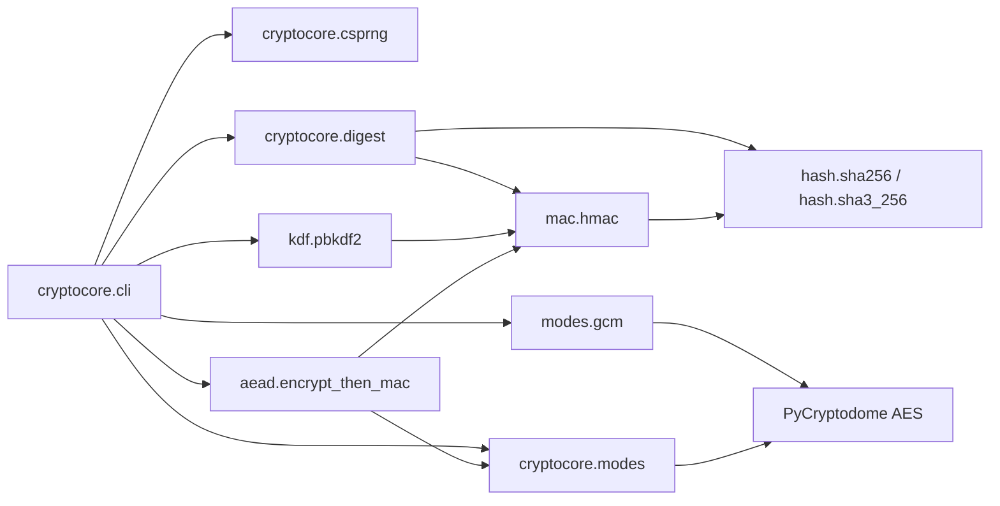

# CryptoCore API — версия 0.8.0 (документационный релиз)

Это описание построено по фактическим исходным модулям CryptoCore. Не все функции являются стабильным внешним API: вспомогательные функции CLI и отдельные AES-примитивы предназначены прежде всего для учебных тестов.

**Совместимость:** Python ≥3.10; тестовая среда пользователя — Python 3.14.0, Windows 10. Реализация AES ограничена AES-128; нет AES-256 и CMAC. Объект `kdf.hkdf` не реализует RFC 5869.

## Карта модулей



## Доступные исключения и ограничения

`PaddingError` — некорректное PKCS#7; `AuthenticationError` — неудачная проверка GCM; `EtMAuthenticationError` — неверная аутентификация EtM; `ArgumentError` — ошибка аргументов CLI. Файловые операции могут возбуждать `OSError`.

Форматы CLI: ECB без IV, CBC/CFB/OFB/CTR — `IV(16)||ciphertext`, GCM — `nonce(12)||ciphertext||tag(16)`, EtM — `nonce(16)||ciphertext||HMAC(32)`. CLI `--aad` ожидает HEX.

## `aead.encrypt_then_mac`

Encrypt-then-MAC: AES-CTR + HMAC-SHA256, 16-байтный мастер-ключ; 16-байтный nonce, 32-байтный тег.

**Ошибки:** ValueError, TypeError, EtMAuthenticationError.

**Безопасность:** Повторное применение nonce с одним ключом небезопасно. Аутентификация проверяется до расшифрования.

**Пример использования:**

```python
from aead import EncryptThenMAC
key = bytes.fromhex("00112233445566778899aabbccddeeff")
packet = EncryptThenMAC(key).encrypt(b"message", aad=b"header")
assert EncryptThenMAC(key).decrypt(packet, aad=b"header") == b"message"
```

### Класс `EtMAuthenticationError`

Raised when EtM authentication or input framing fails.

**Исключения:** ValueError, TypeError, EtMAuthenticationError. **Безопасность:** Повторное применение nonce с одним ключом небезопасно. Аутентификация проверяется до расшифрования.

### Класс `EncryptThenMAC`

AES-128 CTR plus HMAC-SHA256 with independently derived internal keys.

**Исключения:** ValueError, TypeError, EtMAuthenticationError. **Безопасность:** Повторное применение nonce с одним ключом небезопасно. Аутентификация проверяется до расшифрования.

#### `EncryptThenMAC.__init__(self, master_key: bytes) -> None`

Construct the object and validate initialization parameters.

**Исключения:** ValueError, TypeError, EtMAuthenticationError.

**Параметры:** `master_key`. Подробности типизации приведены в сигнатуре; размеры ключей/данных — в байтах.

**Возвращает:** None. **Пример просмотра:** `help(aead.encrypt_then_mac.EncryptThenMAC.__init__)`.

#### `EncryptThenMAC.encrypt(self, plaintext: bytes, aad: bytes=b'', nonce: bytes | None=None) -> bytes`

Encrypt input; return nonce || ciphertext || authentication tag.

**Исключения:** ValueError, TypeError, EtMAuthenticationError.

**Параметры:** `plaintext`, `aad`, `nonce`. Подробности типизации приведены в сигнатуре; размеры ключей/данных — в байтах.

**Возвращает:** bytes. **Пример просмотра:** `help(aead.encrypt_then_mac.EncryptThenMAC.encrypt)`.

#### `EncryptThenMAC.decrypt(self, data: bytes, aad: bytes=b'') -> bytes`

Verify authentication and return the original plaintext bytes.

**Исключения:** ValueError, TypeError, EtMAuthenticationError.

**Параметры:** `data`, `aad`. Подробности типизации приведены в сигнатуре; размеры ключей/данных — в байтах.

**Возвращает:** bytes. **Пример просмотра:** `help(aead.encrypt_then_mac.EncryptThenMAC.decrypt)`.

## `cryptocore.cli`

Аргументы и обработчики CLI AES, dgst, derive; внутренние вспомогательные функции доступны для тестов.

**Ошибки:** ArgumentError, ValueError, OSError; ошибки AEAD возвращают код 1.

**Безопасность:** Пароли и производные ключи могут попасть в историю консоли и stdout; не используйте CLI для реальных секретов без оценки рисков.

**Пример использования:**

```python
from cryptocore.cli import run
code = run(["derive", "--password", "test", "--salt", "73616c74", "--iterations", "1", "--length", "16"])
assert code == 0
```

### Класс `ArgumentError`

Command-line argument validation error.

**Исключения:** ArgumentError, ValueError, OSError; ошибки AEAD возвращают код 1. **Безопасность:** Пароли и производные ключи могут попасть в историю консоли и stdout; не используйте CLI для реальных секретов без оценки рисков.

### `build_parser() -> argparse.ArgumentParser`

Build the AES encryption/decryption command-line parser.

**Возвращает:** argparse.ArgumentParser. **Исключения:** ArgumentError, ValueError, OSError; ошибки AEAD возвращают код 1.

**Мини-пример:** `help(cryptocore.cli.build_parser)` — интроспекция документации функции.

### `build_digest_parser() -> argparse.ArgumentParser`

Build the hashing and HMAC subcommand parser.

**Возвращает:** argparse.ArgumentParser. **Исключения:** ArgumentError, ValueError, OSError; ошибки AEAD возвращают код 1.

**Мини-пример:** `help(cryptocore.cli.build_digest_parser)` — интроспекция документации функции.

### `build_derive_parser() -> argparse.ArgumentParser`

Build the PBKDF2 key-derivation subcommand parser.

**Возвращает:** argparse.ArgumentParser. **Исключения:** ArgumentError, ValueError, OSError; ошибки AEAD возвращают код 1.

**Мини-пример:** `help(cryptocore.cli.build_derive_parser)` — интроспекция документации функции.

### `parse_key(key_text: str) -> bytes`

Validate and decode a 16-byte AES key supplied as 32 HEX characters.

**Возвращает:** bytes. **Исключения:** ArgumentError, ValueError, OSError; ошибки AEAD возвращают код 1.

**Параметры:** `key_text`. Точные ограничения и единицы измерения указаны в сигнатуре/докстринге; ключи, IV, salt и длины передаются в байтах, HEX относится только к CLI.

**Мини-пример:** `help(cryptocore.cli.parse_key)` — интроспекция документации функции.

### `parse_hmac_key(key_text: str) -> bytes`

Validate and decode an arbitrary-length HEX HMAC key.

**Возвращает:** bytes. **Исключения:** ArgumentError, ValueError, OSError; ошибки AEAD возвращают код 1.

**Параметры:** `key_text`. Точные ограничения и единицы измерения указаны в сигнатуре/докстринге; ключи, IV, salt и длины передаются в байтах, HEX относится только к CLI.

**Мини-пример:** `help(cryptocore.cli.parse_hmac_key)` — интроспекция документации функции.

### `parse_iv(iv_text: str) -> bytes`

Validate and decode an AES mode IV represented by 32 HEX characters.

**Возвращает:** bytes. **Исключения:** ArgumentError, ValueError, OSError; ошибки AEAD возвращают код 1.

**Параметры:** `iv_text`. Точные ограничения и единицы измерения указаны в сигнатуре/докстринге; ключи, IV, salt и длины передаются в байтах, HEX относится только к CLI.

**Мини-пример:** `help(cryptocore.cli.parse_iv)` — интроспекция документации функции.

### `parse_nonce(nonce_text: str) -> bytes`

Validate and decode a 12-byte GCM nonce represented by 24 HEX characters.

**Возвращает:** bytes. **Исключения:** ArgumentError, ValueError, OSError; ошибки AEAD возвращают код 1.

**Параметры:** `nonce_text`. Точные ограничения и единицы измерения указаны в сигнатуре/докстринге; ключи, IV, salt и длины передаются в байтах, HEX относится только к CLI.

**Мини-пример:** `help(cryptocore.cli.parse_nonce)` — интроспекция документации функции.

### `parse_aad(aad_text: str | None) -> bytes`

Decode optional HEX-encoded authenticated associated data.

**Возвращает:** bytes. **Исключения:** ArgumentError, ValueError, OSError; ошибки AEAD возвращают код 1.

**Параметры:** `aad_text`. Точные ограничения и единицы измерения указаны в сигнатуре/докстринге; ключи, IV, salt и длины передаются в байтах, HEX относится только к CLI.

**Мини-пример:** `help(cryptocore.cli.parse_aad)` — интроспекция документации функции.

### `resolve_salt(salt_text: str | None) -> bytes`

Parse HEX salt or generate a fresh random 16-byte salt.

**Возвращает:** bytes. **Исключения:** ArgumentError, ValueError, OSError; ошибки AEAD возвращают код 1.

**Параметры:** `salt_text`. Точные ограничения и единицы измерения указаны в сигнатуре/докстринге; ключи, IV, salt и длины передаются в байтах, HEX относится только к CLI.

**Мини-пример:** `help(cryptocore.cli.resolve_salt)` — интроспекция документации функции.

### `resolve_password(args: argparse.Namespace) -> bytearray`

Read a PBKDF2 password into a mutable bytearray without logging its plaintext.

**Возвращает:** bytearray. **Исключения:** ArgumentError, ValueError, OSError; ошибки AEAD возвращают код 1.

**Параметры:** `args`. Точные ограничения и единицы измерения указаны в сигнатуре/докстринге; ключи, IV, salt и длины передаются в байтах, HEX относится только к CLI.

**Мини-пример:** `help(cryptocore.cli.resolve_password)` — интроспекция документации функции.

### `is_weak_key(key: bytes) -> bool`

Identify trivial repeated-byte or arithmetic-sequence AES keys.

**Возвращает:** bool. **Исключения:** ArgumentError, ValueError, OSError; ошибки AEAD возвращают код 1.

**Параметры:** `key`. Точные ограничения и единицы измерения указаны в сигнатуре/докстринге; ключи, IV, salt и длины передаются в байтах, HEX относится только к CLI.

**Мини-пример:** `help(cryptocore.cli.is_weak_key)` — интроспекция документации функции.

### `resolve_key(args: argparse.Namespace) -> bytes`

Parse a supplied AES key or generate a new random key for encryption.

**Возвращает:** bytes. **Исключения:** ArgumentError, ValueError, OSError; ошибки AEAD возвращают код 1.

**Параметры:** `args`. Точные ограничения и единицы измерения указаны в сигнатуре/докстринге; ключи, IV, salt и длины передаются в байтах, HEX относится только к CLI.

**Мини-пример:** `help(cryptocore.cli.resolve_key)` — интроспекция документации функции.

### `get_default_output(input_file: str, decrypt: bool) -> str`

Choose the default encrypted or decrypted file path.

**Возвращает:** str. **Исключения:** ArgumentError, ValueError, OSError; ошибки AEAD возвращают код 1.

**Параметры:** `input_file`, `decrypt`. Точные ограничения и единицы измерения указаны в сигнатуре/докстринге; ключи, IV, salt и длины передаются в байтах, HEX относится только к CLI.

**Мини-пример:** `help(cryptocore.cli.get_default_output)` — интроспекция документации функции.

### `validate_arguments(args: argparse.Namespace) -> str`

Validate compatibility of AES mode, operation and nonce/AAD options.

**Возвращает:** str. **Исключения:** ArgumentError, ValueError, OSError; ошибки AEAD возвращают код 1.

**Параметры:** `args`. Точные ограничения и единицы измерения указаны в сигнатуре/докстринге; ключи, IV, salt и длины передаются в байтах, HEX относится только к CLI.

**Мини-пример:** `help(cryptocore.cli.validate_arguments)` — интроспекция документации функции.

### `encrypt_data(data: bytes, key: bytes, mode: str, aad: bytes | BinaryIO=b'') -> bytes`

Encrypt data using the selected mode and return the self-contained payload.

**Возвращает:** bytes. **Исключения:** ArgumentError, ValueError, OSError; ошибки AEAD возвращают код 1.

**Параметры:** `data`, `key`, `mode`, `aad`. Точные ограничения и единицы измерения указаны в сигнатуре/докстринге; ключи, IV, salt и длины передаются в байтах, HEX относится только к CLI.

**Мини-пример:** `help(cryptocore.cli.encrypt_data)` — интроспекция документации функции.

### `decrypt_data(data: bytes, key: bytes, mode: str, iv_text: str | None, aad: bytes | BinaryIO=b'', nonce_text: str | None=None) -> bytes`

Decrypt payload after validation; AEAD modes authenticate before releasing plaintext.

**Возвращает:** bytes. **Исключения:** ArgumentError, ValueError, OSError; ошибки AEAD возвращают код 1.

**Параметры:** `data`, `key`, `mode`, `iv_text`, `aad`, `nonce_text`. Точные ограничения и единицы измерения указаны в сигнатуре/докстринге; ключи, IV, salt и длины передаются в байтах, HEX относится только к CLI.

**Мини-пример:** `help(cryptocore.cli.decrypt_data)` — интроспекция документации функции.

### `run_digest(argv: list[str]) -> int`

Execute the digest/HMAC CLI and return a process exit status.

**Возвращает:** int. **Исключения:** ArgumentError, ValueError, OSError; ошибки AEAD возвращают код 1.

**Параметры:** `argv`. Точные ограничения и единицы измерения указаны в сигнатуре/докстринге; ключи, IV, salt и длины передаются в байтах, HEX относится только к CLI.

**Мини-пример:** `help(cryptocore.cli.run_digest)` — интроспекция документации функции.

### `run_derive(argv: list[str]) -> int`

Execute PBKDF2 CLI, emit key HEX and salt HEX, and best-effort zero mutable buffers.

**Возвращает:** int. **Исключения:** ArgumentError, ValueError, OSError; ошибки AEAD возвращают код 1.

**Параметры:** `argv`. Точные ограничения и единицы измерения указаны в сигнатуре/докстринге; ключи, IV, salt и длины передаются в байтах, HEX относится только к CLI.

**Мини-пример:** `help(cryptocore.cli.run_derive)` — интроспекция документации функции.

### `run(argv: list[str] | None=None) -> int`

Dispatch to the selected CryptoCore CLI operation.

**Возвращает:** int. **Исключения:** ArgumentError, ValueError, OSError; ошибки AEAD возвращают код 1.

**Параметры:** `argv`. Точные ограничения и единицы измерения указаны в сигнатуре/докстринге; ключи, IV, salt и длины передаются в байтах, HEX относится только к CLI.

**Мини-пример:** `help(cryptocore.cli.run)` — интроспекция документации функции.

### `main() -> int`

Console script entry point returning an integer process status.

**Возвращает:** int. **Исключения:** ArgumentError, ValueError, OSError; ошибки AEAD возвращают код 1.

**Мини-пример:** `help(cryptocore.cli.main)` — интроспекция документации функции.

## `cryptocore.csprng`

Системная криптографически стойкая генерация случайных байтов.

**Ошибки:** TypeError или ValueError для недопустимых размеров.

**Безопасность:** Случайные ключи выводятся в CLI при отсутствии --key: сохраните их отдельно.

**Пример использования:**

```python
from cryptocore.csprng import generate_random_bytes
assert len(generate_random_bytes(16)) == 16
```

### `generate_random_bytes(num_bytes: int) -> bytes`

Return num_bytes of cryptographically secure OS-generated randomness.

**Возвращает:** bytes. **Исключения:** TypeError или ValueError для недопустимых размеров.

**Параметры:** `num_bytes`. Точные ограничения и единицы измерения указаны в сигнатуре/докстринге; ключи, IV, salt и длины передаются в байтах, HEX относится только к CLI.

**Мини-пример:** `help(cryptocore.csprng.generate_random_bytes)` — интроспекция документации функции.

## `cryptocore.digest`

Потоковое чтение файла/потока и вычисление SHA-256, SHA3-256 и HMAC-SHA256.

**Ошибки:** ValueError, TypeError, OSError.

**Безопасность:** Простые хеши не проверяют подлинность. Для проверки подлинности используйте HMAC.

**Пример использования:**

```python
from cryptocore.digest import hash_stream
from io import BytesIO
print(hash_stream(BytesIO(b"hello"), "sha256"))
```

### `create_hasher(algorithm: str) -> не аннотирован`

Construct the requested SHA256 or SHA3_256 incremental hasher.

**Возвращает:** см. реализацию. **Исключения:** ValueError, TypeError, OSError.

**Параметры:** `algorithm`. Точные ограничения и единицы измерения указаны в сигнатуре/докстринге; ключи, IV, salt и длины передаются в байтах, HEX относится только к CLI.

**Мини-пример:** `help(cryptocore.digest.create_hasher)` — интроспекция документации функции.

### `hash_stream(stream: BinaryIO, algorithm: str) -> str`

Hash a binary stream in bounded-size chunks and return HEX.

**Возвращает:** str. **Исключения:** ValueError, TypeError, OSError.

**Параметры:** `stream`, `algorithm`. Точные ограничения и единицы измерения указаны в сигнатуре/докстринге; ключи, IV, salt и длины передаются в байтах, HEX относится только к CLI.

**Мини-пример:** `help(cryptocore.digest.hash_stream)` — интроспекция документации функции.

### `hash_file(input_file: str, algorithm: str) -> str`

Hash the specified file or standard input (-) and return HEX.

**Возвращает:** str. **Исключения:** ValueError, TypeError, OSError.

**Параметры:** `input_file`, `algorithm`. Точные ограничения и единицы измерения указаны в сигнатуре/докстринге; ключи, IV, salt и длины передаются в байтах, HEX относится только к CLI.

**Мини-пример:** `help(cryptocore.digest.hash_file)` — интроспекция документации функции.

### `hmac_stream(stream: BinaryIO, key: bytes) -> str`

Compute HMAC-SHA256 over a binary stream and return HEX.

**Возвращает:** str. **Исключения:** ValueError, TypeError, OSError.

**Параметры:** `stream`, `key`. Точные ограничения и единицы измерения указаны в сигнатуре/докстринге; ключи, IV, salt и длины передаются в байтах, HEX относится только к CLI.

**Мини-пример:** `help(cryptocore.digest.hmac_stream)` — интроспекция документации функции.

### `hmac_file(input_file: str, key: bytes) -> str`

Compute HMAC-SHA256 over the file or standard input (-).

**Возвращает:** str. **Исключения:** ValueError, TypeError, OSError.

**Параметры:** `input_file`, `key`. Точные ограничения и единицы измерения указаны в сигнатуре/докстринге; ключи, IV, salt и длины передаются в байтах, HEX относится только к CLI.

**Мини-пример:** `help(cryptocore.digest.hmac_file)` — интроспекция документации функции.

### `format_digest(hash_value: str, input_file: str) -> str`

Format a hash and path with two separating spaces.

**Возвращает:** str. **Исключения:** ValueError, TypeError, OSError.

**Параметры:** `hash_value`, `input_file`. Точные ограничения и единицы измерения указаны в сигнатуре/докстринге; ключи, IV, salt и длины передаются в байтах, HEX относится только к CLI.

**Мини-пример:** `help(cryptocore.digest.format_digest)` — интроспекция документации функции.

### `format_hmac(hmac_value: str, input_file: str) -> str`

Format an HMAC and path with one separating space.

**Возвращает:** str. **Исключения:** ValueError, TypeError, OSError.

**Параметры:** `hmac_value`, `input_file`. Точные ограничения и единицы измерения указаны в сигнатуре/докстринге; ключи, IV, salt и длины передаются в байтах, HEX относится только к CLI.

**Мини-пример:** `help(cryptocore.digest.format_hmac)` — интроспекция документации функции.

### `read_expected_hmac(input_file: str) -> str`

Read and validate the expected 32-byte HMAC from a text file.

**Возвращает:** str. **Исключения:** ValueError, TypeError, OSError.

**Параметры:** `input_file`. Точные ограничения и единицы измерения указаны в сигнатуре/докстринге; ключи, IV, salt и длины передаются в байтах, HEX относится только к CLI.

**Мини-пример:** `help(cryptocore.digest.read_expected_hmac)` — интроспекция документации функции.

### `write_digest_output(output_file: str, result: str) -> None`

Write the formatted digest or HMAC line to a UTF-8 text file.

**Возвращает:** None. **Исключения:** ValueError, TypeError, OSError.

**Параметры:** `output_file`, `result`. Точные ограничения и единицы измерения указаны в сигнатуре/докстринге; ключи, IV, salt и длины передаются в байтах, HEX относится только к CLI.

**Мини-пример:** `help(cryptocore.digest.write_digest_output)` — интроспекция документации функции.

## `cryptocore.file_io`

Функции чтения и записи целых файлов в бинарном режиме.

**Ошибки:** OSError, TypeError.

**Безопасность:** Файлы целиком читаются в память; для больших файлов использовать потоковые API.

**Пример использования:**

```python
from cryptocore.file_io import write_binary, read_binary
write_binary("sample.bin", b"data")
assert read_binary("sample.bin") == b"data"
```

### `read_binary(path: str | Path) -> bytes`

Read the entire file contents as bytes.

**Возвращает:** bytes. **Исключения:** OSError, TypeError.

**Параметры:** `path`. Точные ограничения и единицы измерения указаны в сигнатуре/докстринге; ключи, IV, salt и длины передаются в байтах, HEX относится только к CLI.

**Мини-пример:** `help(cryptocore.file_io.read_binary)` — интроспекция документации функции.

### `write_binary(path: str | Path, data: bytes) -> None`

Write bytes to a binary output file.

**Возвращает:** None. **Исключения:** OSError, TypeError.

**Параметры:** `path`, `data`. Точные ограничения и единицы измерения указаны в сигнатуре/докстринге; ключи, IV, salt и длины передаются в байтах, HEX относится только к CLI.

**Мини-пример:** `help(cryptocore.file_io.write_binary)` — интроспекция документации функции.

## `cryptocore.modes.cbc`

AES-128 CBC с PKCS#7.

**Ошибки:** ValueError, PaddingError.

**Безопасность:** CBC без MAC допускает модификацию шифртекста; используйте AEAD для реальных данных.

**Пример использования:**

```python
from cryptocore.modes.cbc import encrypt_cbc, decrypt_cbc
key, iv = b"0" * 16, b"1" * 16
assert decrypt_cbc(encrypt_cbc(b"hello", key, iv), key, iv) == b"hello"
```

### `encrypt_cbc(data: bytes, key: bytes, iv: bytes) -> bytes`

Encrypt a message with AES-128 CBC and PKCS#7 padding.

**Возвращает:** bytes. **Исключения:** ValueError, PaddingError.

**Параметры:** `data`, `key`, `iv`. Точные ограничения и единицы измерения указаны в сигнатуре/докстринге; ключи, IV, salt и длины передаются в байтах, HEX относится только к CLI.

**Мини-пример:** `help(cryptocore.modes.cbc.encrypt_cbc)` — интроспекция документации функции.

### `decrypt_cbc(data: bytes, key: bytes, iv: bytes) -> bytes`

Decrypt AES-128 CBC and remove PKCS#7 padding.

**Возвращает:** bytes. **Исключения:** ValueError, PaddingError.

**Параметры:** `data`, `key`, `iv`. Точные ограничения и единицы измерения указаны в сигнатуре/докстринге; ключи, IV, salt и длины передаются в байтах, HEX относится только к CLI.

**Мини-пример:** `help(cryptocore.modes.cbc.decrypt_cbc)` — интроспекция документации функции.

## `cryptocore.modes.cfb`

AES-128 CFB-128.

**Ошибки:** ValueError, TypeError.

**Безопасность:** CFB не аутентифицирует данные.

**Пример использования:**

```python
from cryptocore.modes.cfb import encrypt_cfb, decrypt_cfb
key, iv = b"0" * 16, b"1" * 16
assert decrypt_cfb(encrypt_cfb(b"hello", key, iv), key, iv) == b"hello"
```

### `encrypt_cfb(data: bytes, key: bytes, iv: bytes) -> bytes`

Encrypt any-length bytes with AES-128 CFB-128.

**Возвращает:** bytes. **Исключения:** ValueError, TypeError.

**Параметры:** `data`, `key`, `iv`. Точные ограничения и единицы измерения указаны в сигнатуре/докстринге; ключи, IV, salt и длины передаются в байтах, HEX относится только к CLI.

**Мини-пример:** `help(cryptocore.modes.cfb.encrypt_cfb)` — интроспекция документации функции.

### `decrypt_cfb(data: bytes, key: bytes, iv: bytes) -> bytes`

Decrypt any-length bytes with AES-128 CFB-128.

**Возвращает:** bytes. **Исключения:** ValueError, TypeError.

**Параметры:** `data`, `key`, `iv`. Точные ограничения и единицы измерения указаны в сигнатуре/докстринге; ключи, IV, salt и длины передаются в байтах, HEX относится только к CLI.

**Мини-пример:** `help(cryptocore.modes.cfb.decrypt_cfb)` — интроспекция документации функции.

## `cryptocore.modes.common`

Проверка 16-байтных ключей/IV и операция XOR.

**Ошибки:** ValueError, TypeError.

**Безопасность:** Для AES используются только 16-байтные ключи.

**Пример использования:**

```python
from cryptocore.modes.common import validate_key, xor_bytes
validate_key(b"0" * 16)
assert xor_bytes(b"\x01", b"\x03") == b"\x02"
```

### `validate_key(key: bytes) -> None`

Require a 16-byte AES-128 key.

**Возвращает:** None. **Исключения:** ValueError, TypeError.

**Параметры:** `key`. Точные ограничения и единицы измерения указаны в сигнатуре/докстринге; ключи, IV, salt и длины передаются в байтах, HEX относится только к CLI.

**Мини-пример:** `help(cryptocore.modes.common.validate_key)` — интроспекция документации функции.

### `validate_iv(iv: bytes) -> None`

Require a 16-byte IV for classical AES modes.

**Возвращает:** None. **Исключения:** ValueError, TypeError.

**Параметры:** `iv`. Точные ограничения и единицы измерения указаны в сигнатуре/докстринге; ключи, IV, salt и длины передаются в байтах, HEX относится только к CLI.

**Мини-пример:** `help(cryptocore.modes.common.validate_iv)` — интроспекция документации функции.

### `xor_bytes(left: bytes, right: bytes) -> bytes`

XOR corresponding bytes of two inputs; output length is the shorter input.

**Возвращает:** bytes. **Исключения:** ValueError, TypeError.

**Параметры:** `left`, `right`. Точные ограничения и единицы измерения указаны в сигнатуре/докстринге; ключи, IV, salt и длины передаются в байтах, HEX относится только к CLI.

**Мини-пример:** `help(cryptocore.modes.common.xor_bytes)` — интроспекция документации функции.

## `cryptocore.modes.ctr`

AES-128 CTR, 128-битный счётчик big-endian.

**Ошибки:** ValueError, TypeError.

**Безопасность:** Повторное использование начального счётчика/IV с ключом недопустимо.

**Пример использования:**

```python
from cryptocore.modes.ctr import encrypt_ctr, decrypt_ctr
key, iv = b"0" * 16, b"1" * 16
assert decrypt_ctr(encrypt_ctr(b"hello", key, iv), key, iv) == b"hello"
```

### `process_ctr(data: bytes, key: bytes, iv: bytes) -> bytes`

Apply the symmetric AES-CTR keystream transform.

**Возвращает:** bytes. **Исключения:** ValueError, TypeError.

**Параметры:** `data`, `key`, `iv`. Точные ограничения и единицы измерения указаны в сигнатуре/докстринге; ключи, IV, salt и длины передаются в байтах, HEX относится только к CLI.

**Мини-пример:** `help(cryptocore.modes.ctr.process_ctr)` — интроспекция документации функции.

### `encrypt_ctr(data: bytes, key: bytes, iv: bytes) -> bytes`

Encrypt any-length bytes with AES-128 CTR.

**Возвращает:** bytes. **Исключения:** ValueError, TypeError.

**Параметры:** `data`, `key`, `iv`. Точные ограничения и единицы измерения указаны в сигнатуре/докстринге; ключи, IV, salt и длины передаются в байтах, HEX относится только к CLI.

**Мини-пример:** `help(cryptocore.modes.ctr.encrypt_ctr)` — интроспекция документации функции.

### `decrypt_ctr(data: bytes, key: bytes, iv: bytes) -> bytes`

Decrypt any-length bytes with AES-128 CTR.

**Возвращает:** bytes. **Исключения:** ValueError, TypeError.

**Параметры:** `data`, `key`, `iv`. Точные ограничения и единицы измерения указаны в сигнатуре/докстринге; ключи, IV, salt и длины передаются в байтах, HEX относится только к CLI.

**Мини-пример:** `help(cryptocore.modes.ctr.decrypt_ctr)` — интроспекция документации функции.

## `cryptocore.modes.ecb`

AES-128 ECB с PKCS#7; отдельные функции padding.

**Ошибки:** ValueError, PaddingError.

**Безопасность:** ECB не скрывает повторение блоков и не даёт аутентификацию.

**Пример использования:**

```python
from cryptocore.modes.ecb import encrypt_ecb, decrypt_ecb
key = b"0" * 16
assert decrypt_ecb(encrypt_ecb(b"hello", key), key) == b"hello"
```

### Класс `PaddingError`

Raised when PKCS#7 padding is malformed.

**Исключения:** ValueError, PaddingError. **Безопасность:** ECB не скрывает повторение блоков и не даёт аутентификацию.

### `pkcs7_pad(data: bytes, block_size: int=BLOCK_SIZE) -> bytes`

Append PKCS#7 padding so output is a multiple of block_size.

**Возвращает:** bytes. **Исключения:** ValueError, PaddingError.

**Параметры:** `data`, `block_size`. Точные ограничения и единицы измерения указаны в сигнатуре/докстринге; ключи, IV, salt и длины передаются в байтах, HEX относится только к CLI.

**Мини-пример:** `help(cryptocore.modes.ecb.pkcs7_pad)` — интроспекция документации функции.

### `pkcs7_unpad(data: bytes, block_size: int=BLOCK_SIZE) -> bytes`

Validate and strip PKCS#7 padding.

**Возвращает:** bytes. **Исключения:** ValueError, PaddingError.

**Параметры:** `data`, `block_size`. Точные ограничения и единицы измерения указаны в сигнатуре/докстринге; ключи, IV, salt и длины передаются в байтах, HEX относится только к CLI.

**Мини-пример:** `help(cryptocore.modes.ecb.pkcs7_unpad)` — интроспекция документации функции.

### `encrypt_ecb(data: bytes, key: bytes) -> bytes`

Encrypt a message with AES-128 ECB after PKCS#7 padding.

**Возвращает:** bytes. **Исключения:** ValueError, PaddingError.

**Параметры:** `data`, `key`. Точные ограничения и единицы измерения указаны в сигнатуре/докстринге; ключи, IV, salt и длины передаются в байтах, HEX относится только к CLI.

**Мини-пример:** `help(cryptocore.modes.ecb.encrypt_ecb)` — интроспекция документации функции.

### `decrypt_ecb(data: bytes, key: bytes) -> bytes`

Decrypt AES-128 ECB and remove PKCS#7 padding.

**Возвращает:** bytes. **Исключения:** ValueError, PaddingError.

**Параметры:** `data`, `key`. Точные ограничения и единицы измерения указаны в сигнатуре/докстринге; ключи, IV, salt и длины передаются в байтах, HEX относится только к CLI.

**Мини-пример:** `help(cryptocore.modes.ecb.decrypt_ecb)` — интроспекция документации функции.

## `cryptocore.modes.ofb`

AES-128 OFB.

**Ошибки:** ValueError, TypeError.

**Безопасность:** Нельзя повторять IV с ключом; сам по себе режим не аутентифицирует данные.

**Пример использования:**

```python
from cryptocore.modes.ofb import encrypt_ofb, decrypt_ofb
key, iv = b"0" * 16, b"1" * 16
assert decrypt_ofb(encrypt_ofb(b"hello", key, iv), key, iv) == b"hello"
```

### `process_ofb(data: bytes, key: bytes, iv: bytes) -> bytes`

Apply the symmetric AES-OFB keystream transform.

**Возвращает:** bytes. **Исключения:** ValueError, TypeError.

**Параметры:** `data`, `key`, `iv`. Точные ограничения и единицы измерения указаны в сигнатуре/докстринге; ключи, IV, salt и длины передаются в байтах, HEX относится только к CLI.

**Мини-пример:** `help(cryptocore.modes.ofb.process_ofb)` — интроспекция документации функции.

### `encrypt_ofb(data: bytes, key: bytes, iv: bytes) -> bytes`

Encrypt any-length bytes with AES-128 OFB.

**Возвращает:** bytes. **Исключения:** ValueError, TypeError.

**Параметры:** `data`, `key`, `iv`. Точные ограничения и единицы измерения указаны в сигнатуре/докстринге; ключи, IV, salt и длины передаются в байтах, HEX относится только к CLI.

**Мини-пример:** `help(cryptocore.modes.ofb.encrypt_ofb)` — интроспекция документации функции.

### `decrypt_ofb(data: bytes, key: bytes, iv: bytes) -> bytes`

Decrypt any-length bytes with AES-128 OFB.

**Возвращает:** bytes. **Исключения:** ValueError, TypeError.

**Параметры:** `data`, `key`, `iv`. Точные ограничения и единицы измерения указаны в сигнатуре/докстринге; ключи, IV, salt и длины передаются в байтах, HEX относится только к CLI.

**Мини-пример:** `help(cryptocore.modes.ofb.decrypt_ofb)` — интроспекция документации функции.

## `hash.sha256`

Самостоятельная реализация инкрементального SHA-256, без hashlib для хеша.

**Ошибки:** TypeError для некорректного входа.

**Безопасность:** Не подходит для MAC: используйте HMAC.

**Пример использования:**

```python
from hash import SHA256
h = SHA256(); h.update(b"hello")
assert len(h.digest()) == 32
```

### Класс `SHA256`

Incremental SHA-256 hash context.

**Исключения:** TypeError для некорректного входа. **Безопасность:** Не подходит для MAC: используйте HMAC.

#### `SHA256.__init__(self) -> None`

Construct the object and validate initialization parameters.

**Исключения:** TypeError для некорректного входа.

**Возвращает:** None. **Пример просмотра:** `help(hash.sha256.SHA256.__init__)`.

#### `SHA256.copy(self) -> 'SHA256'`

Return an independent copy of the current hashing or MAC state.

**Исключения:** TypeError для некорректного входа.

**Возвращает:** 'SHA256'. **Пример просмотра:** `help(hash.sha256.SHA256.copy)`.

#### `SHA256.update(self, data: bytes | bytearray | memoryview) -> SHA256`

Absorb additional binary input and return the updated object.

**Исключения:** TypeError для некорректного входа.

**Параметры:** `data`. Подробности типизации приведены в сигнатуре; размеры ключей/данных — в байтах.

**Возвращает:** SHA256. **Пример просмотра:** `help(hash.sha256.SHA256.update)`.

#### `SHA256.digest(self) -> bytes`

Return final digest bytes without modifying the original state.

**Исключения:** TypeError для некорректного входа.

**Возвращает:** bytes. **Пример просмотра:** `help(hash.sha256.SHA256.digest)`.

#### `SHA256.hexdigest(self) -> str`

Return the digest as a lowercase HEX string.

**Исключения:** TypeError для некорректного входа.

**Возвращает:** str. **Пример просмотра:** `help(hash.sha256.SHA256.hexdigest)`.

#### `SHA256.hash(cls, data: bytes | bytearray | memoryview) -> str`

Compute the digest of supplied data (class convenience method).

**Исключения:** TypeError для некорректного входа.

**Параметры:** `data`. Подробности типизации приведены в сигнатуре; размеры ключей/данных — в байтах.

**Возвращает:** str. **Пример просмотра:** `help(hash.sha256.SHA256.hash)`.

## `hash.sha3_256`

Самостоятельная реализация инкрементального SHA3-256, без hashlib для хеша.

**Ошибки:** TypeError для некорректного входа.

**Безопасность:** Не подходит для MAC: используйте HMAC.

**Пример использования:**

```python
from hash import SHA3_256
h = SHA3_256(); h.update(b"hello")
assert len(h.digest()) == 32
```

### Класс `SHA3_256`

Incremental SHA3-256 hash context.

**Исключения:** TypeError для некорректного входа. **Безопасность:** Не подходит для MAC: используйте HMAC.

#### `SHA3_256.__init__(self) -> None`

Construct the object and validate initialization parameters.

**Исключения:** TypeError для некорректного входа.

**Возвращает:** None. **Пример просмотра:** `help(hash.sha3_256.SHA3_256.__init__)`.

#### `SHA3_256.copy(self) -> 'SHA3_256'`

Return an independent copy of the current hashing or MAC state.

**Исключения:** TypeError для некорректного входа.

**Возвращает:** 'SHA3_256'. **Пример просмотра:** `help(hash.sha3_256.SHA3_256.copy)`.

#### `SHA3_256.update(self, data: bytes | bytearray | memoryview) -> 'SHA3_256'`

Absorb additional binary input and return the updated object.

**Исключения:** TypeError для некорректного входа.

**Параметры:** `data`. Подробности типизации приведены в сигнатуре; размеры ключей/данных — в байтах.

**Возвращает:** 'SHA3_256'. **Пример просмотра:** `help(hash.sha3_256.SHA3_256.update)`.

#### `SHA3_256.digest(self) -> bytes`

Return final digest bytes without modifying the original state.

**Исключения:** TypeError для некорректного входа.

**Возвращает:** bytes. **Пример просмотра:** `help(hash.sha3_256.SHA3_256.digest)`.

#### `SHA3_256.hexdigest(self) -> str`

Return the digest as a lowercase HEX string.

**Исключения:** TypeError для некорректного входа.

**Возвращает:** str. **Пример просмотра:** `help(hash.sha3_256.SHA3_256.hexdigest)`.

#### `SHA3_256.hash(cls, data: bytes | bytearray | memoryview) -> str`

Compute the digest of supplied data (class convenience method).

**Исключения:** TypeError для некорректного входа.

**Параметры:** `data`. Подробности типизации приведены в сигнатуре; размеры ключей/данных — в байтах.

**Возвращает:** str. **Пример просмотра:** `help(hash.sha3_256.SHA3_256.hash)`.

## `kdf.hkdf`

Учебная иерархия HMAC(master_key, context || counter), не RFC 5869 HKDF.

**Ошибки:** TypeError, ValueError.

**Безопасность:** Для каждого назначения используйте уникальный context.

**Пример использования:**

```python
from kdf import derive_key
master = b"0" * 32
assert derive_key(master, "encryption", 32) != derive_key(master, "authentication", 32)
```

### `derive_key(master_key: bytes, context: str, length: int=32) -> bytes`

Derive a context-separated key with HMAC(master_key, context || BE32(counter)).

**Возвращает:** bytes. **Исключения:** TypeError, ValueError.

**Параметры:** `master_key`, `context`, `length`. Точные ограничения и единицы измерения указаны в сигнатуре/докстринге; ключи, IV, salt и длины передаются в байтах, HEX относится только к CLI.

**Мини-пример:** `help(kdf.hkdf.derive_key)` — интроспекция документации функции.

## `kdf.pbkdf2`

PBKDF2-HMAC-SHA256 на собственной HMAC, dklen 1..65536 байт.

**Ошибки:** TypeError, ValueError.

**Безопасность:** Большое число итераций может вызвать длительные вычисления; пароль очищается только best-effort внутри CLI.

**Пример использования:**

```python
from kdf import pbkdf2_hmac_sha256
key = pbkdf2_hmac_sha256(b"password", b"salt", 2, 32)
assert len(key) == 32
```

### `pbkdf2_hmac_sha256(password: bytes | bytearray | str, salt: bytes, iterations: int, dklen: int) -> bytes`

Derive exactly dklen key bytes using PBKDF2-HMAC-SHA256; maximum 65536 bytes.

**Возвращает:** bytes. **Исключения:** TypeError, ValueError.

**Параметры:** `password`, `salt`, `iterations`, `dklen`. Точные ограничения и единицы измерения указаны в сигнатуре/докстринге; ключи, IV, salt и длины передаются в байтах, HEX относится только к CLI.

**Мини-пример:** `help(kdf.pbkdf2.pbkdf2_hmac_sha256)` — интроспекция документации функции.

## `mac.hmac`

Самостоятельный HMAC-SHA256 поверх собственной SHA256.

**Ошибки:** TypeError при некорректном ключе/входных данных.

**Безопасность:** Сравнение MAC выполнять через secrets.compare_digest().

**Пример использования:**

```python
from mac import HMAC
h = HMAC(b"key"); h.update(b"message")
assert len(h.digest()) == 32
```

### Класс `HMAC`

Incremental HMAC-SHA256 context using the bundled SHA256 algorithm.

**Исключения:** TypeError при некорректном ключе/входных данных. **Безопасность:** Сравнение MAC выполнять через secrets.compare_digest().

#### `HMAC.__init__(self, key: bytes | bytearray | memoryview) -> None`

Construct the object and validate initialization parameters.

**Исключения:** TypeError при некорректном ключе/входных данных.

**Параметры:** `key`. Подробности типизации приведены в сигнатуре; размеры ключей/данных — в байтах.

**Возвращает:** None. **Пример просмотра:** `help(mac.hmac.HMAC.__init__)`.

#### `HMAC.copy(self) -> 'HMAC'`

Return an independent copy of the current hashing or MAC state.

**Исключения:** TypeError при некорректном ключе/входных данных.

**Возвращает:** 'HMAC'. **Пример просмотра:** `help(mac.hmac.HMAC.copy)`.

#### `HMAC.update(self, data: bytes | bytearray | memoryview) -> 'HMAC'`

Absorb additional binary input and return the updated object.

**Исключения:** TypeError при некорректном ключе/входных данных.

**Параметры:** `data`. Подробности типизации приведены в сигнатуре; размеры ключей/данных — в байтах.

**Возвращает:** 'HMAC'. **Пример просмотра:** `help(mac.hmac.HMAC.update)`.

#### `HMAC.digest(self) -> bytes`

Return final digest bytes without modifying the original state.

**Исключения:** TypeError при некорректном ключе/входных данных.

**Возвращает:** bytes. **Пример просмотра:** `help(mac.hmac.HMAC.digest)`.

#### `HMAC.hexdigest(self) -> str`

Return the digest as a lowercase HEX string.

**Исключения:** TypeError при некорректном ключе/входных данных.

**Возвращает:** str. **Пример просмотра:** `help(mac.hmac.HMAC.hexdigest)`.

#### `HMAC.compute(cls, key: bytes | bytearray | memoryview, data: bytes | bytearray | memoryview) -> str`

Compute an HMAC and return its lowercase HEX representation.

**Исключения:** TypeError при некорректном ключе/входных данных.

**Параметры:** `key`, `data`. Подробности типизации приведены в сигнатуре; размеры ключей/данных — в байтах.

**Возвращает:** str. **Пример просмотра:** `help(mac.hmac.HMAC.compute)`.

## `modes.gcm`

AES-128 GCM, GHASH, потоковое чтение AAD.

**Ошибки:** AuthenticationError, ValueError, TypeError.

**Безопасность:** Запрещён повтор nonce с ключом; тег проверяется до возврата plaintext. Python GHASH не constant-time.

**Пример использования:**

```python
from modes import GCM
key = bytes.fromhex("00112233445566778899aabbccddeeff")
packet = GCM(key).encrypt(b"message", aad=b"header")
assert GCM(key, packet[:12]).decrypt(packet, aad=b"header") == b"message"
```

### Класс `AuthenticationError`

Raised when GCM authentication or input framing fails.

**Исключения:** AuthenticationError, ValueError, TypeError. **Безопасность:** Запрещён повтор nonce с ключом; тег проверяется до возврата plaintext. Python GHASH не constant-time.

### Класс `GCM`

AES-128 GCM instance with one-use encryption nonce and AAD authentication.

**Исключения:** AuthenticationError, ValueError, TypeError. **Безопасность:** Запрещён повтор nonce с ключом; тег проверяется до возврата plaintext. Python GHASH не constant-time.

#### `GCM.__init__(self, key: bytes, nonce: bytes | None=None) -> None`

Construct the object and validate initialization parameters.

**Исключения:** AuthenticationError, ValueError, TypeError.

**Параметры:** `key`, `nonce`. Подробности типизации приведены в сигнатуре; размеры ключей/данных — в байтах.

**Возвращает:** None. **Пример просмотра:** `help(modes.gcm.GCM.__init__)`.

#### `GCM.encrypt(self, plaintext: bytes, aad: bytes | BinaryIO=b'') -> bytes`

Encrypt input; return nonce || ciphertext || authentication tag.

**Исключения:** AuthenticationError, ValueError, TypeError.

**Параметры:** `plaintext`, `aad`. Подробности типизации приведены в сигнатуре; размеры ключей/данных — в байтах.

**Возвращает:** bytes. **Пример просмотра:** `help(modes.gcm.GCM.encrypt)`.

#### `GCM.decrypt(self, data: bytes, aad: bytes | BinaryIO=b'', includes_nonce: bool=True) -> bytes`

Verify authentication and return the original plaintext bytes.

**Исключения:** AuthenticationError, ValueError, TypeError.

**Параметры:** `data`, `aad`, `includes_nonce`. Подробности типизации приведены в сигнатуре; размеры ключей/данных — в байтах.

**Возвращает:** bytes. **Пример просмотра:** `help(modes.gcm.GCM.decrypt)`.

